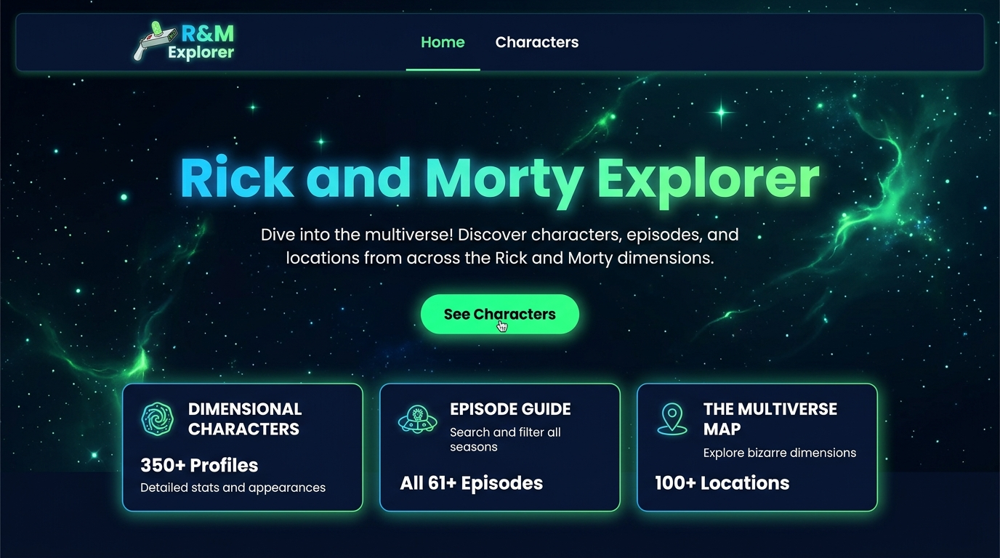
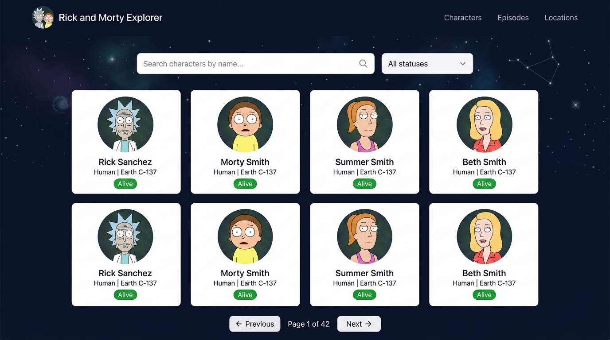

# Assignment 5: PS4 — Rick and Morty Explorer

[](https://vitejs.dev/)
[](https://react.dev/)
[](https://reactrouter.com/)

A modern, responsive multi-page web application built with React and React Router to explore characters, dimensions, and realities across the Rick and Morty multiverse.

---

## 📌 Project Overview
- **Assignment**: Assignment-5
- **Problem Statement**: PS4 — Rick and Morty Explorer
- **Academic Level**: First-Year B.Tech Computer Science & Engineering
- **Target Repository Name**: `ps4-rick-and-morty-explorer`
- **Live Deployment URL**: `[Deployment in Progress - Add URL After Deployment]`

---

## 🚀 Technologies Used
- **Frontend Library**: [React 19](https://reactjs.org/) (Functional Components, Hooks: `useState`, `useEffect`)
- **Routing**: [React Router 7](https://reactrouter.com/) (`BrowserRouter`, `Routes`, `Route`, `Link`, `NavLink`, `useParams`, `useSearchParams`)
- **Build Tool**: [Vite 8](https://vitejs.dev/)
- **Styling**: Vanilla CSS (CSS Custom Properties design system, space aesthetic, responsive grid, zero external CSS framework bloat)
- **API Fetching**: Native browser `fetch` API with `AbortController` cancellation for clean asynchronous requests

---

## 🌐 API Used
- **Data Provider**: [The Rick and Morty API](https://rickandmortyapi.com/)
- **Documentation**: https://rickandmortyapi.com/documentation
- **Authentication**: None required (Public REST API)
- **Endpoints Utilized**:
  - `GET https://rickandmortyapi.com/api/character/?page={page}&name={name}&status={status}`
  - `GET https://rickandmortyapi.com/api/character/{id}`

---

## 🗺️ Implemented Routes

| Route | Component | Description |
|---|---|---|
| `/` | `Home` | Landing page featuring responsive navbar, space-themed hero banner, introductory mission brief, and prominent "See Characters" call to action. |
| `/characters` | `Characters` | Character explorer with responsive grid, name search, status dropdown filter, and pagination buttons. |
| `/characters/:id` | `CharacterDetails` | Dedicated character profile displaying image, status badge, species, gender, origin, current location, and episode appearance count. |
| `*` | `NotFound` | Graceful 404 handler for unrecognized paths with return-to-home navigation. |

---

## ✨ Features
1. **Responsive Character Grid**:
   - Cards display character portrait, full name, species, and color-coded status badge.
   - Image aspect ratios and object fits prevent image distortion.
2. **Color-Coded Status Badges**:
   - 🟢 **Alive**: Vibrant green badge with pulse dot.
   - 🔴 **Dead**: Red warning badge.
   - ⚪ **unknown**: Neutral grey badge.
3. **Controlled Search Filter**:
   - Controlled text input filtering characters dynamically by name with debouncing to prevent excessive API requests.
4. **Bonus — Status Filter**:
   - Dropdown with *All statuses*, *Alive*, *Dead*, and *Unknown*.
   - Dynamically appends `status` query to API calls and resets pagination to page 1.
5. **Bonus — URL-Synchronized Pagination**:
   - Keeps current page, search keyword, and status filter in URL search parameters (`?page=1&name=...&status=...`).
   - Browser refresh, sharing links, and forward/back buttons preserve state.
   - Previous disabled on page 1, Next disabled on last page.
6. **Detailed Character Profile**:
   - Deep insights including origin dimension, latest location, gender, and episode count (`character.episode.length`).
   - Quick "Back to Characters" and "Home Page" navigation links.
7. **Comprehensive Error & Edge-Case Handling**:
   - Loading indicator during asynchronous fetches.
   - Friendly empty-state banner when no characters match query criteria.
   - Human-readable error screen for non-existent IDs or network connection failures.
   - Request cancellation to eliminate race conditions and avoid displaying stale results.

---

## 📸 Screenshots

### 1. Home Page


### 2. Characters Directory & Filters


---

## ⚙️ Installation & Local Setup

### Prerequisites
- [Node.js](https://nodejs.org/) (version 18 or newer recommended)
- `npm` (comes with Node.js)

### Steps
1. **Clone the repository**:
   ```bash
   git clone https://github.com/<YOUR_GITHUB_USERNAME>/ps4-rick-and-morty-explorer.git
   cd ps4-rick-and-morty-explorer
   ```

2. **Install project dependencies**:
   ```bash
   npm install
   ```

3. **Start the local development server**:
   ```bash
   npm run dev
   ```
   Open your browser and navigate to `http://localhost:5173`.

---

## 🏗️ Production Build

To build the optimized static production bundle:
```bash
npm run build
```

To preview the built production bundle locally:
```bash
npm run preview
```

---

## 🚢 Deployment Instructions

### Deploying to Vercel
1. Push your repository to GitHub under the name `ps4-rick-and-morty-explorer`.
2. Log in to [Vercel](https://vercel.com/) and click **Add New Project**.
3. Import your `ps4-rick-and-morty-explorer` repository.
4. The build framework is automatically detected as **Vite**.
5. Ensure the Root Directory is `./`.
6. Click **Deploy**.
7. Client-side routing is handled by the included [`vercel.json`](./vercel.json) rewrite rule:
   ```json
   {
     "rewrites": [
       {
         "source": "/(.*)",
         "destination": "/"
       }
     ]
   }
   ```

### Deploying to Netlify
1. Create a `_redirects` file in `public/_redirects` with:
   ```text
   /*    /index.html   200
   ```
2. Connect your GitHub repository to [Netlify](https://www.netlify.com/).
3. Set build command to `npm run build` and publish directory to `dist`.
4. Click **Deploy**.

---

## 📂 Project Structure

```text
assignment-05/
├── docs/
│   └── screenshots/
│       ├── home.jpg
│       └── characters.jpg
├── public/
│   ├── favicon.svg
│   └── icons.svg
├── src/
│   ├── components/
│   │   ├── CharacterCard.jsx   # Individual character display card
│   │   ├── Loading.jsx         # Dimensional portal loading spinner
│   │   ├── Navbar.jsx          # Top navigation bar
│   │   └── StatusBadge.jsx     # Alive/Dead/Unknown status indicator
│   ├── pages/
│   │   ├── CharacterDetails.jsx # Character profile view (/characters/:id)
│   │   ├── Characters.jsx       # Grid list with search & filters (/characters)
│   │   ├── Home.jsx             # Hero landing page (/)
│   │   └── NotFound.jsx         # 404 Route handler (*)
│   ├── App.jsx                  # Route definitions & layout shell
│   ├── index.css                # Global space-themed CSS design system
│   └── main.jsx                 # React root bootstrap
├── index.html                   # HTML entry point with Google Fonts
├── package.json                 # Project dependencies & scripts
├── vercel.json                  # SPA routing configuration for Vercel
└── vite.config.js               # Vite bundler configuration
```
